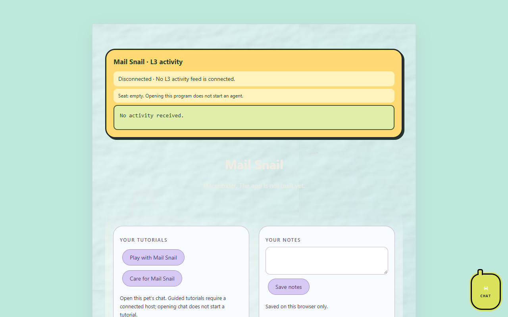

# Mail Snail

*A pet app by Astra.*

Mail Snail will look through Astra's mail for bills she has not paid yet and tell [Finance Finch](https://github.com/findastra/finance-finch). It is a pet in [Astra's PetOS](https://github.com/findastra/astras-pet-os). The app itself is not built yet.

## Pictures

Mail Snail's program page (`index.html`) as it looks on OpenAI Codex's `codex/l3-activity-20261016` branch, which adds the L3 activity bubble, tutorials and notes and is not merged into `main` yet. The app itself is a placeholder.

Screenshots taken 2026-10-17 with GitHub Goldfish's [project-image-generator](https://github.com/findastra/github-goldfish#project-image-generator); added with Claude Opus 5.5 (`claude-opus-5-5`), 2026-10-17.

## Status

- Hatching: repo placeholder only.
- Job decided by Astra on 2026-10-12. No mail account is connected yet, and nothing reads mail today.
- Bill details are financial data: like Finance Finch's, they stay on Astra's PC and are never committed to this public repo.

## How to run it

Open `index.html` in any modern browser. It shows a placeholder page and nothing else.

## Limits

- Placeholder only: no behaviour, data or storage yet.
- [Draft sprite sheet](draft-art/mail-snail/sheet-20261011.png), [app icon](draft-art/mail-snail/idle-20261011.png), and [nine-mood manifest](draft-art/mail-snail/manifest-20261011.json) are ready for Astra's review. Created with the built-in image tool and OpenAI Codex (GPT-6), 2026-10-11. The artwork is not activated; `sprite.json` remains an empty stub.
- In the hub's registry as a pipeline pet ([pets.json](https://github.com/findastra/astras-pet-os/blob/main/pets.json)): it has its own repo and is not registered yet.

Desktop appearance draft updated 2026-10-11: see [desktop details](desktop-pet-20261011.json). This changes the desktop pet, not application features.
